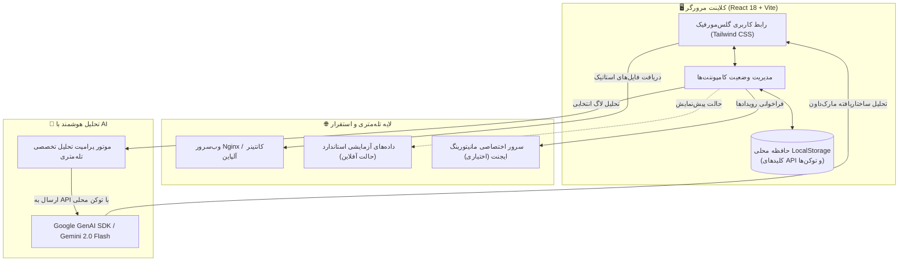

<div align="center">


# داشبورد نظارت و هوشمندی عامل‌های هوش مصنوعی نکسورا (Nexora AI Monitor)

**سامانه پیشرفته نظارت برخط، ثبت لاگ‌های چندکاناله و تحلیل هوشمند عملکرد بات‌ها و ایجنت‌های هوش مصنوعی**

[](./LICENSE)
[](./.github/workflows/ci.yml)
[](./Dockerfile)
[](https://react.dev/)
[](https://www.typescriptlang.org/)
[](https://tailwindcss.com/)
[](https://ai.google.dev/)

[English](./README.md) • [فارسی](./README.fa.md) • [تحلیل فنی معماری](./docs/PROJECT_ANALYSIS.md) • [خط‌مشی امنیتی](./SECURITY.md)

</div>

---

<div dir="rtl">

## 📌 معرفی پروژه

**مانیتور نکسورا (Nexora AI Monitor)** یک داشبورد مدرن، چشم‌نواز و فوق‌العاده سریع تحت وب برای رصد، رهگیری و ارزیابی لحظه‌ای رفتار ایجنت‌های خودمختار و ربات‌های هوش مصنوعی (مانند ربات‌های تلگرام، مدل‌های پشتیبانی مشتریان و خطوط لوله LLM) است. این سامانه با استفاده از **React 18**، **TypeScript** و **Tailwind CSS** ساخته شده و از پشتیبانی دوطرفه و راست‌به‌چپ (RTL) به زبان فارسی، فونت بهینه‌سازی‌شده **وزیرمتن**، حالت‌های تیره و روشن گلس‌مورفیک، و عیب‌یابی خودکار بر پایه **Google Gemini 2.0 Flash** بهره می‌برد.

با نکسورا می‌توانید معیارهایی چون نرخ موفقیت، تاخیر زمانی (Latency)، حجم مصرفی توکن‌ها، جریان کاربران فعال و ریز تراکنش‌های مالی را در یک نگاه کنترل کنید.

---

## ✨ امکانات کلیدی

- ⚡ **تله‌متری و شاخص‌های کلیدی (KPIs) لحظه‌ای**: نمایش تعداد کل درخواست‌ها، کاربران فعال، میانگین زمان پاسخ‌دهی و درصد پایداری سرویس‌ها با شاخص‌های بصری پویا.
- 🤖 **تحلیل عمیق لاگ‌ها با Gemini 2.0 Flash**: عیب‌یابی تک‌کلیکه و ریشه‌یابی خطاهای ایجنت، کشف قصد و لحن کاربر، و دریافت راهکارهای فنی مستقیماً از هوش مصنوعی گوگل.
- 🎨 **طراحی گلس‌مورفیزم و تم دوگانه (Dark / Light)**: رابط کاربری مدرن با افکت شیشه‌ای محو (Backdrop Blur)، هماهنگی رنگی چشم‌نواز و تغییر تم آنی.
- 🌐 **پشتیبانی کامل از زبان فارسی و چینش RTL**: استفاده از فونت استاندارد Vazirmatn، نمایش تاریخ‌های خورشیدی و فرمت‌بندی اعداد و ریال متناسب با کاربران فارسی‌زبان.
- 🛡️ **امنیت کامل و حذف اطلاعات حساس (DevSecOps Clean)**: عدم وجود هیچ‌گونه کلید یا رمز عبور هاردکد شده در کد منبع؛ دریافت داینامیک کلیدها از `localStorage` مرورگر یا متغیرهای محیطی.
- 🔍 **مدال‌های جزییات پیشرفته**: امکان بررسی کامل Payload ورودی، خروجی خام مدل، خطاها، متادیتا و متغیرهای نشست با هایلایت ساختار JSON.
- 📊 **فیلتر و جستجوی پیشرفته**: قابلیت تفکیک رویدادها بر اساس کانال ورودی (تلگرام، وب، واتساپ)، وضعیت (`SUCCESS`، `ERROR`، `WARNING`) و بازه زمانی.
- 🐳 **کانتینرسازی بهینه با داکر**: ایمیج چندمرحله‌ای بر پایه Nginx Alpine با حجم بسیار پایین (~۲۵ مگابایت) و مسیریابی SPA.

---

## 📸 گالری تصاویر داشبورد

<div align="center">

### 🌙 داشبورد در تم تیره (Dark Mode)

*نمای کلی ایجنت‌ها با کارت‌های KPI، نمودارهای تحلیلی و جدول رویدادهای زنده*

<br/>

### ☀️ داشبورد در تم روشن (Light Mode)

*رابط کاربری چشم‌نواز با کنتراست عالی برای محیط‌های پرنور*

<br/>

| زبانه عملکرد و پایداری (Performance) | فهرست و تعامل کاربران (Users) |
| :---: | :---: |
|  |  |
| *توزیع تاخیر زمانی، نرخ خطا و توان عملیاتی سیستم* | *اطلاعات کاربران، کانال‌های ورودی و حجم درخواست‌ها* |

| ثبت و ارزیابی مالی (Transactions) | تحلیل هوشمند لاگ با هوش مصنوعی Gemini |
| :---: | :---: |
|  |  |
| *گزارش تراکنش‌ها، درگاه‌های پرداخت و تراز مالی* | *ریشه‌یابی خودکار علت شکست با گوگل جمینای ۲.۰ فلش* |

### ⚙️ تنظیمات و مدیریت امن کلیدها در مرورگر

*ورود امن کلید API بدون دستکاری در سورس‌کد و با ذخیره‌سازی محلی در حافظه مرورگر*

</div>

---

## 🏗️ معماری و جریان داده‌ها

نمودار زیر نحوه جریان داده، تفکیک کلیدهای امنیتی و پردازش لاگ‌ها توسط مدل جمینای را نشان می‌دهد:



---

## 🛠️ فناوری‌های مورد استفاده

| بخش | فناوری | توضیحات |
| :--- | :--- | :--- |
| **هسته فرانت‌اند** | [React 18.3](https://react.dev/) | معماری مدرن بر پایه کامپوننت و مدیریت کارآمد رندر |
| **زبان برنامه‌نویسی** | [TypeScript 5.5](https://www.typescriptlang.org/) | تایپ‌سیفتی دقیق، پیشگیری از باگ‌های ران‌تایم و کد تمیز |
| **ابزار بیلد** | [Vite 5.4](https://vitejs.dev/) | سرور توسعه فوق‌سریع و خروجی بهینه‌شده پروداکشن |
| **استایل‌دهی** | [Tailwind CSS 3.4](https://tailwindcss.com/) | فریم‌ورک یوتیلیتی-فرست با توکن‌های گلس‌مورفیک و راست‌به‌چپ |
| **آیکون‌ها** | [Lucide React](https://lucide.dev/) | مجموعه آیکون‌های برداری سبک و واکنش‌گرا |
| **هوش مصنوعی** | [Google Gemini 2.0 Flash](https://ai.google.dev/) | پردازش فوق سریع لاگ‌ها و خلاصه‌سازی ساختاریافته علل خطا |
| **کانتینرسازی** | [Docker](https://www.docker.com/) + [Nginx Alpine](https://nginx.org/) | پکیج کامپکت و پروداکشن با حجم اندک (~۲۵ مگابایت) |
| **تایپوگرافی** | [وزیرمتن (Vazirmatn)](https://github.com/rastikerdar/vazirmatn) و Inter | فونت استاندارد و فوق‌العاده چشم‌نواز وب فارسی و انگلیسی |

---

## 🚀 راهنمای سریع راه‌اندازی

### روش اول: اجرای تحت داکر (Docker) — توصیه شده

سریع‌ترین راه برای اجرای نسخه کامپایل‌شده پروداکشن روی پورت ۳۰۰۰:

```bash
# ۱. کلون ریپازیتوری
git clone https://github.com/Mahdi-Soleimani/NexoraAILog.git
cd NexoraAILog

# ۲. ساخت و اجرای ایمیج داکر
docker compose up -d --build

# ۳. باز کردن در مرورگر
# نشانی: http://localhost:3000
```

برای متوقف کردن کانتینر:
```bash
docker compose down
```

---

### روش دوم: توسعه محلی با Node.js

پیش‌نیازها: **Node.js نسخه ۱۸ به بالا** و **npm نسخه ۹ به بالا**.

```bash
# ۱. کلون ریپازیتوری
git clone https://github.com/Mahdi-Soleimani/NexoraAILog.git
cd NexoraAILog

# ۲. نصب پکیج‌ها
npm install

# ۳. تنظیم فایل محیطی بر پایه نمونه امن
cp .env.example .env

# ۴. اجرای سرور توسعه Vite
npm run dev

# ۵. باز کردن نشانی http://localhost:5173 در مرورگر
```

---

## ⚙️ تنظیمات و ورود امن اطلاعات حساس و شخصی

داشبورد مانیتورینگ نکسورا بر پایه **معماری بدون نشت (Zero-Leak Architecture)** طراحی شده است. شما یا هر کاربری که از این پروژه استفاده می‌کند، نیازی به قرار دادن کلیدها یا پسوردهای شخصی درون کدهای پروژه ندارید و اطلاعات شما هرگز روی گیت‌هاب منتشر نخواهد شد.

### 🔐 راهنمای ورود اطلاعات حساس شخصی (۲ روش کاملاً ایزوله)

#### روش اول: ورود از طریق رابط کاربری در مرورگر (توصیه شده — بدون نیاز به کانفیگ فایل)
۱. داشبورد را در مرورگر باز کنید.
۲. روی آیکون **تنظیمات (⚙️ چرخ‌دنده)** در نوار بالای صفحه کلیک کنید.
۳. کلید هوش مصنوعی **Google Gemini API Key** خود را وارد نمایید (دریافت رایگان از [Google AI Studio](https://aistudio.google.com/app/apikey)).
۴. *(اختیاری)* آدرس **وب‌هوک اختصاصی ایجنت** یا ربات خود به همراه **توکن احراز هویت (Bearer Token)** را وارد کنید.
۵. دکمه **«ذخیره تنظیمات و تست ارتباط»** را بزنید.
> **تضمین حریم خصوصی و امنیت**: تمام اطلاعات و کلیدهای ورودی صرفاً در حافظه محلی مرورگر شما (`localStorage`) ذخیره می‌شوند و هرگز به سرور دیگری یا ریپازیتوری ارسال نخواهند شد.

#### روش دوم: استفاده از متغیرهای محیطی (`.env`) برای استقرار سرور و داکر
در صورتی که پروژه را روی سرور یا کانتینر داکر اجرا می‌کنید:
```bash
# ۱. کپی فایل نمونه (که در .gitignore مسدود است و کامیت نمی‌شود)
cp .env.example .env

# ۲. باز کردن و ثبت متغیرها
nano .env
```

| متغیر | وضعیت | پیش‌فرض | توضیحات |
| :--- | :---: | :---: | :--- |
| `VITE_GEMINI_API_KEY` | اختیاری | `""` | کلید گوگل استودیو برای فعال‌سازی تحلیلگر هوشمند Gemini 2.0 Flash |
| `VITE_DEFAULT_WEBHOOK_URL`| اختیاری | `""` | آدرس پیش‌فرض سرور شما برای واکشی لاگ‌های برخط |
| `VITE_DEFAULT_AUTH_TOKEN` | اختیاری | `""` | توکن احراز هویت Bearer برای برقراری ارتباط با وب‌هوک شما |
| `VITE_COST_PER_TOKEN` | اختیاری | `0.5` | هزینه هر توکن بر حسب تومان برای محاسبه هزینه‌های مصرفی |
| `VITE_BASE_PATH` | اختیاری | `./` | آدرس ریشه استقرار (مانند گیت‌هاب پیجز) |

> [!TIP]
> پروژه با داده‌های آزمایشی واقعی (Enterprise Demo Data) تنظیم شده است؛ بنابراین بدون نیاز به وارد کردن هیچ کلیدی، تمام بخش‌ها و نمودارها فوراً قابل آزمایش و استفاده هستند!

---

## 🌐 استقرار روی سرورهای لینوکس (VPS + Nginx)

برای اجرای مستقیم فایل‌های بیلد در کنار سایر سرویس‌های لینوکس اوبونتو/دبیان:

### ۱. ساخت بیلد پروداکشن
```bash
npm run build
# خروجی نهایی در پوشه dist قرار می‌گیرد
```

### ۲. انتقال فایل‌ها به مسیر وب‌سرور
```bash
sudo mkdir -p /var/www/nexora
sudo cp -r dist/* /var/www/nexora/
sudo chown -R www-data:www-data /var/www/nexora
```

### ۳. پیکربندی وب‌سرور انجین‌ایکس (`/etc/nginx/sites-available/nexora.conf`)
```nginx
server {
    listen 80;
    server_name nexora.yourdomain.ir;

    root /var/www/nexora;
    index index.html;

    # هدرهای امنیتی
    add_header X-Frame-Options "SAMEORIGIN" always;
    add_header X-Content-Type-Options "nosniff" always;
    add_header X-XSS-Protection "1; mode=block" always;
    add_header Referrer-Policy "no-referrer-when-downgrade" always;

    # حل مشکل روتینگ SPA
    location / {
        try_files $uri $uri/ /index.html;
    }

    # بهینه‌سازی کش فایل‌های استاتیک
    location ~* \.(js|css|png|jpg|jpeg|gif|ico|svg|woff|woff2|ttf)$ {
        expires 1y;
        add_header Cache-Control "public, no-transform";
    }

    gzip on;
    gzip_types text/plain text/css application/json application/javascript text/xml application/xml application/xml+rss text/javascript image/svg+xml;
}
```

فعال‌سازی کانفیگ و ری‌لود انجین‌ایکس:
```bash
sudo ln -s /etc/nginx/sites-available/nexora.conf /etc/nginx/sites-enabled/
sudo nginx -t && sudo systemctl reload nginx
```

---

## 🗺️ برنامه توسعه و قابلیت‌های آینده (Roadmap)

- [x] انتشار رسمی نسخه متن‌باز v1.0.0 با پشتیبانی کامل دوزبانه و RTL.
- [x] اتصال تک‌کلیکه به هوش مصنوعی گوگل جمینای ۲.۰ فلش.
- [x] آماده‌سازی کامل کانتینر چندمرحله‌ای داکر با پایش سلامت (Healthcheck).
- [x] پشتیبانی از حالت‌های نمایش تیره و روشن گلس‌مورفیک.
- [ ] اتصال وب‌سوکت برای دریافت لاگ‌های زنده استریمینگ.
- [ ] قابلیت استخراج گزارش‌های آماری به فرمت‌های PDF و CSV.
- [ ] وب‌هوک هشدار لحظه‌ای روی تلگرام و بله برای افزایش نرخ خطا.
- [ ] ساختار سازمان‌های چندمستاجره (Multi-tenant) و سطوح دسترسی (RBAC).

---

## 🤝 مشارکت در پروژه

مشارکت‌های شما به هر نحوی (گزارش باگ، پیشنهاد امکانات جدید، بهینه‌سازی کد یا مستندات) بسیار ارزشمند است!

لطفاً پیش از ارسال درخواست، [راهنمای مشارکت (Contributing)](./CONTRIBUTING.md) و [مرام‌نامه اخلاقی (Code of Conduct)](./CODE_OF_CONDUCT.md) را مطالعه فرمایید.

```bash
# بررسی استاندارد کدها
npm run lint

# تست سلامت بیلد پروداکشن
npm run build
```

---

## 🔒 امنیت و گزارش آسیب‌پذیری

امنیت داده‌ها و اطلاعات کاربران اولویت بنیادین ماست. در صورتی که با آسیب‌پذیری یا مشکلی امنیتی مواجه شدید، لطفاً بر اساس دستورالعمل‌های مندرج در [سیاست امنیتی (SECURITY.md)](./SECURITY.md) اقدام نمایید و از ثبت عمومی آسیب‌پذیری‌ها در بخش Issueهای گیت‌هاب خودداری فرمایید.

---

## 📄 مجوز انتشار (License)

این پروژه تحت مجوز آزاد **MIT** منتشر شده است. برای کسب اطلاعات بیشتر فایل [`LICENSE`](./LICENSE) را مشاهده نمایید.

---

<div align="center">

توسعه‌یافته با اشتیاق توسط [مهدی سلیمانی](https://github.com/Mahdi-Soleimani).  
*اگر این ابزار برای شما مفید بود، لطفاً با دادن ستاره (⭐) در گیت‌هاب از پروژه حمایت کنید!*

</div>

</div>
