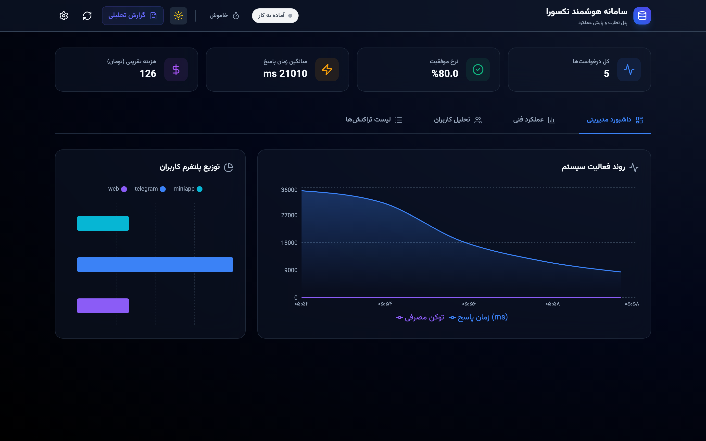
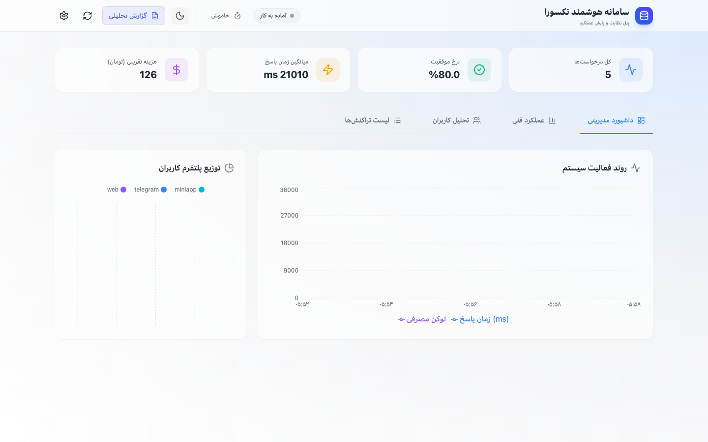
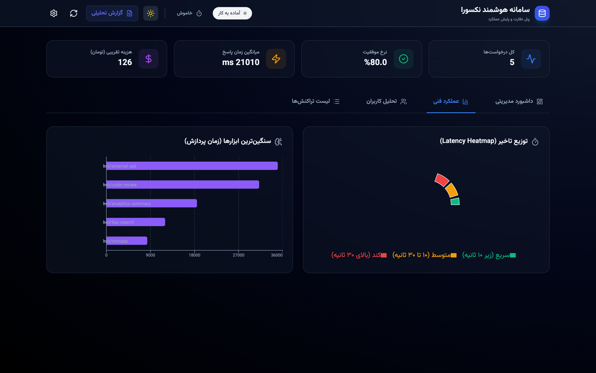
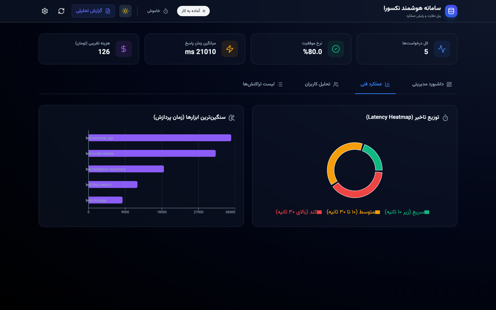
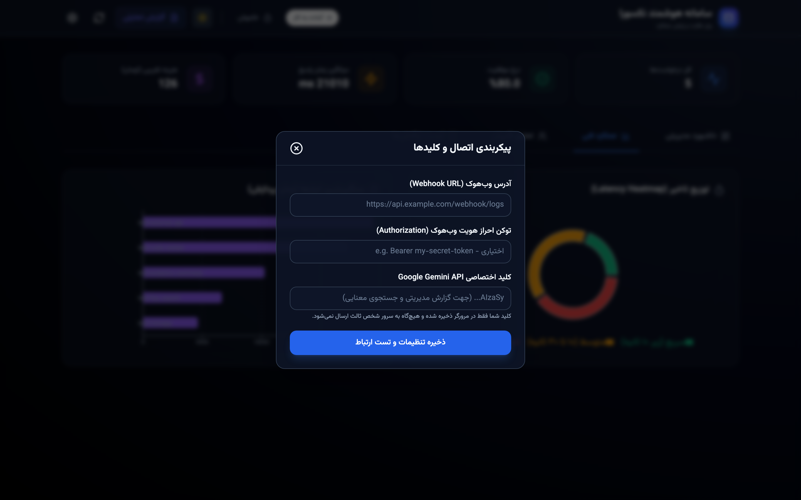
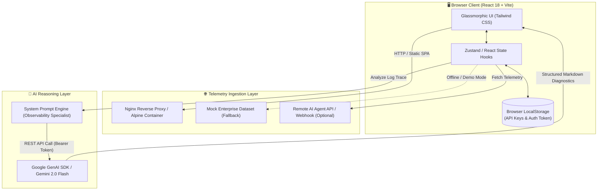

<div align="center">



# Nexora AI Monitor

**Enterprise-Grade Observability, Multi-Channel Audit &amp; Real-Time Intelligence Dashboard for AI Agents**

[](./LICENSE)
[](./.github/workflows/ci.yml)
[](./Dockerfile)
[](https://react.dev/)
[](https://www.typescriptlang.org/)
[](https://tailwindcss.com/)
[](https://ai.google.dev/)

[English](./README.md) • [فارسی (Persian)](./README.fa.md) • [Architecture Report](./docs/PROJECT_ANALYSIS.md) • [Security Policy](./SECURITY.md)

</div>

---

## 📌 Overview

**Nexora AI Monitor** is a modern, high-performance web dashboard designed to observe, trace, audit, and analyze autonomous AI agents and bot interactions in real time. Built with **React 18**, **TypeScript**, and **Tailwind CSS**, it features full bilingual (English / Persian RTL) localization, glassmorphic dark/light aesthetics, integrated **Google Gemini 2.0 Flash AI** log synthesis, and containerized Docker readiness.

Whether monitoring autonomous Telegram bots, customer-support LLM pipelines, or multi-turn reasoning agents, Nexora delivers crystal-clear operational visibility into latency, token consumption, execution success rates, user journeys, and financial transactions.

---

## ✨ Key Features

- ⚡ **Real-Time Telemetry &amp; KPIs**: Monitor total requests, active users, average latency (ms), and success rates with instantaneous visual health cues.
- 🤖 **Gemini 2.0 Flash AI Intelligence**: Trigger single-click AI log investigations. Analyze user intent, detect sentiment anomalies, extract system failure root causes, and generate proactive architectural recommendations.
- 🎨 **Glassmorphism &amp; Dual Themes**: Pixel-perfect dark and light themes with backdrop blur, glowing accent indicators, and smooth state transitions.
- 🌐 **First-Class RTL &amp; Persian Support**: Seamless bidirectional design with typography tailored for **Vazirmatn** and **Inter**, including dedicated Persian solar calendar conversions and localized currency formatting.
- 🛡️ **Zero Hardcoded Secrets (DevSecOps Clean)**: Runtime credentials injected via browser `localStorage` or `.env` variables—zero secrets stored in code or git history.
- 🔍 **Deep Inspection Modals**: Drill down into raw input payloads, LLM responses, execution traces, token consumption, and timestamps with JSON syntax highlighting.
- 📊 **Dynamic Filtering &amp; Search**: Filter agent logs by service channel (e.g., Telegram, Web, WhatsApp), status (`SUCCESS`, `ERROR`, `WARNING`), and timestamp ranges.
- 🐳 **Production-Ready Docker**: Multi-stage minimal Alpine image with Nginx SPA fallback routing, HTTP caching, and automated health checks.

---

## 📸 Screenshots Showcase

<div align="center">

### 🌙 Dark Mode Dashboard

*Real-time agent overview featuring active KPIs, service distribution, and live trace table.*

<br/>

### ☀️ Light Mode Dashboard

*Crisp high-contrast daylight theme with adaptive glassmorphic components.*

<br/>

| Performance &amp; Metrics | User Directory &amp; Cohorts |
| :---: | :---: |
|  |  |
| *Latency distributions, error breakdown &amp; throughput* | *User metadata, active channels &amp; message volume* |

| Financial Audit &amp; Transactions | Gemini 2.0 Flash AI Log Diagnosis |
| :---: | :---: |
|  |  |
| *Subscription plans, payment gateways &amp; ledger* | *Automated reasoning, sentiment &amp; failure root causes* |

### ⚙️ Runtime Settings &amp; Dynamic Secret Management

*Secure browser-level API key management with zero exposure to source code.*

</div>

---

## 🏗️ System Architecture

The following diagram illustrates the unidirectional data flow, authentication boundary, and AI synthesis pipeline:



---

## 🛠️ Tech Stack

| Domain | Technology | Description |
| :--- | :--- | :--- |
| **Frontend Core** | [React 18.3](https://react.dev/) | Declarative component architecture &amp; concurrent rendering |
| **Language** | [TypeScript 5.5](https://www.typescriptlang.org/) | Strict type safety, clean interfaces &amp; zero runtime type regressions |
| **Build Tool** | [Vite 5.4](https://vitejs.dev/) | Lightning-fast HMR and optimized Rollup production bundling |
| **Styling** | [Tailwind CSS 3.4](https://tailwindcss.com/) | Utility-first styling with custom glassmorphism and RTL tokens |
| **Icons** | [Lucide React](https://lucide.dev/) | Clean, accessible, lightweight vector iconography |
| **AI Integration** | [Google Gemini 2.0 Flash](https://ai.google.dev/) | Near-instantaneous AI log diagnostics and root-cause synthesis |
| **Containerization** | [Docker](https://www.docker.com/) + [Nginx Alpine](https://nginx.org/) | Lightweight multi-stage production container (~25MB) |
| **Typography** | [Vazirmatn](https://github.com/rastikerdar/vazirmatn) &amp; Inter | Elegant bilingual typography loaded via Google Fonts |

---

## 🚀 Quick Start

### Option A: Running with Docker (Recommended)

Run the containerized production dashboard in under 30 seconds:

```bash
# 1. Clone the repository
git clone https://github.com/Mahdi-Soleimani/NexoraAILog.git
cd NexoraAILog

# 2. Build and launch with Docker Compose
docker compose up -d --build

# 3. Open your browser
# Navigate to: http://localhost:3000
```

To stop the container:
```bash
docker compose down
```

---

### Option B: Local Node.js Development

Prerequisites: **Node.js 18+** and **npm 9+**.

```bash
# 1. Clone repository
git clone https://github.com/Mahdi-Soleimani/NexoraAILog.git
cd NexoraAILog

# 2. Install dependencies
npm install

# 3. Create your environment file
cp .env.example .env

# 4. Start Vite development server
npm run dev

# 5. Open http://localhost:5173
```

---

## ⚙️ Configuration &amp; Personal Credentials

Nexora AI Monitor is designed with a **Zero-Leak Architecture**. You never need to hardcode API keys or credentials into the code or commit them to Git.

### 🔐 How to Securely Configure Your Personal Credentials

You have two simple and completely private options to configure your credentials:

#### 1. In-Browser Runtime Configuration (Recommended — Zero Setup)
1. Launch or visit the dashboard in your web browser.
2. Click the **Settings (⚙️)** gear icon in the top header bar.
3. Paste your **Google Gemini API Key** (obtain a free key at [Google AI Studio](https://aistudio.google.com/app/apikey)).
4. *(Optional)* Enter your custom bot/agent **Webhook URL** and **Bearer Token** to stream live events.
5. Click **Save Settings & Test Connection**.
> **Privacy Guarantee**: All keys entered in the UI are stored exclusively in your browser's private `localStorage`. They are never sent to any server, repository, or third party.

#### 2. Environment File for Self-Hosted Deployments (`.env`)
If self-hosting via Docker or deploying to a private server:
```bash
# 1. Copy the template (already ignored by .gitignore)
cp .env.example .env

# 2. Add your keys securely
nano .env
```

| Variable | Required | Default | Description |
| :--- | :---: | :---: | :--- |
| `VITE_GEMINI_API_KEY` | Optional | `""` | Google AI Studio API key used for Gemini 2.0 Flash diagnostics. |
| `VITE_DEFAULT_WEBHOOK_URL`| Optional | `""` | Default backend API / webhook URL for streaming live agent logs. |
| `VITE_DEFAULT_AUTH_TOKEN` | Optional | `""` | Bearer authorization token for securing your custom webhook API. |
| `VITE_COST_PER_TOKEN` | Optional | `0.5` | Cost in Tomans per token for financial computation. |
| `VITE_BASE_PATH` | Optional | `./` | Base URL path for deploying under subdirectories (e.g. GitHub Pages). |

> [!TIP]
> The repository is pre-configured with realistic enterprise demo data. You can explore and test all features immediately without entering any credentials!

---

## 🌐 Production VPS &amp; Nginx Deployment

To deploy Nexora AI Monitor behind an existing system Nginx on Ubuntu / Debian:

### 1. Build the Static Assets
```bash
npm run build
# Output files are generated in ./dist
```

### 2. Copy Build to Webroot
```bash
sudo mkdir -p /var/www/nexora
sudo cp -r dist/* /var/www/nexora/
sudo chown -R www-data:www-data /var/www/nexora
```

### 3. Nginx Server Block (`/etc/nginx/sites-available/nexora.conf`)
```nginx
server {
    listen 80;
    server_name nexora.example.com;

    root /var/www/nexora;
    index index.html;

    # Security Headers
    add_header X-Frame-Options "SAMEORIGIN" always;
    add_header X-Content-Type-Options "nosniff" always;
    add_header X-XSS-Protection "1; mode=block" always;
    add_header Referrer-Policy "no-referrer-when-downgrade" always;

    # SPA Routing Fallback
    location / {
        try_files $uri $uri/ /index.html;
    }

    # Static Asset Caching
    location ~* \.(js|css|png|jpg|jpeg|gif|ico|svg|woff|woff2|ttf)$ {
        expires 1y;
        add_header Cache-Control "public, no-transform";
    }

    gzip on;
    gzip_types text/plain text/css application/json application/javascript text/xml application/xml application/xml+rss text/javascript image/svg+xml;
}
```

Enable the site and reload Nginx:
```bash
sudo ln -s /etc/nginx/sites-available/nexora.conf /etc/nginx/sites-enabled/
sudo nginx -t && sudo systemctl reload nginx
```

---

## 🗺️ Roadmap

- [x] Initial v1.0.0 open-source release with full RTL/LTR support.
- [x] Single-click Google Gemini 2.0 Flash log reasoning.
- [x] Multi-stage Docker containerization and health checks.
- [x] High-contrast dual dark and light themes.
- [ ] WebSocket-based live streaming ingestion pipeline.
- [ ] Exportable audit reports (PDF &amp; CSV).
- [ ] Automated Slack / Telegram alert webhooks for error spikes.
- [ ] Multi-tenant organization support and RBAC.

---

## 🤝 Contributing

Contributions make the open-source community an incredible place to learn, inspire, and create. Any contributions you make are **greatly appreciated**.

Please review our [Contributing Guidelines](./CONTRIBUTING.md) and [Code of Conduct](./CODE_OF_CONDUCT.md) before submitting pull requests.

```bash
# Run lint check
npm run lint

# Run production build validation
npm run build
```

---

## 🔒 Security

Security is of paramount importance to us. If you discover any security vulnerabilities or have concerns regarding credential handling, please consult our [Security Policy](./SECURITY.md) for reporting procedures. **Never file public issues for zero-day vulnerabilities.**

---

## 📄 License

Distributed under the **MIT License**. See [`LICENSE`](./LICENSE) for more information.

---

<div align="center">

Crafted with care by [Mahdi Soleimani](https://github.com/Mahdi-Soleimani).  
*If you find this project helpful, please consider giving it a ⭐ on GitHub!*

</div>
