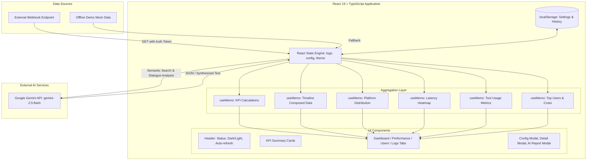

# Nexora AI Observability & Monitoring Dashboard — Project Analysis

## 1. Executive Summary & Purpose

**Nexora AI Observability & Monitoring Dashboard** (`NexoraAILog`) is an open-source, client-side real-time observability and telemetry analytics panel engineered for AI agents, chatbots, and generative AI services (specifically tailored for Telegram bots, Telegram MiniApps, and Web-based AI assistants).

### The Problem It Solves
1. **Lack of Operational Visibility**: When operating AI agents on messaging platforms (like Telegram or customer portals), engineering leads and executives lack real-time visibility into what users are asking, how tools are performing, and where failure points emerge.
2. **Hidden Latency & Performance Bottlenecks**: LLM workflows chain multiple tools, vector lookups, and function calls. Without granular telemetry, identifying slow tool executions (>30s) versus fast queries (<10s) is challenging.
3. **Uncontrolled Token Consumption & Costs**: Generative models consume tokens per interaction. Teams need instant token tracking and cost projection (denominated in local currencies such as Toman or USD) broken down by user role and department.
4. **Information Asymmetry for Executives**: Non-technical leadership requires high-level managerial summaries rather than raw JSON logs.

---

## 2. Complete Feature Inventory

### 2.1 Core Telemetry & KPI Engine
- **Live Metric Counter Cards**:
  - Total Request Volume (`stats.total`) with growth trend indicator.
  - Success / Error Rate (`stats.successRate%`) with status badge visualizer.
  - Average Latency in milliseconds (`stats.avgTime`).
  - Estimated Financial Cost calculated dynamically from token consumption.

### 2.2 Deep Analytics & Data Visualization (Powered by Recharts)
- **Activity & Latency Timeline (`ComposedChart`)**:
  - Dual-axis visualizer: Area gradient for response latency (ms) and Line chart for token usage over time.
- **Platform Distribution (`BarChart`)**:
  - Breakdown of requests originating from Telegram bots, Telegram MiniApps, Web portals, and external APIs.
- **Latency Heatmap / Distribution (`PieChart / Donut`)**:
  - Bucketed categorization into Fast (< 10s), Medium (10s – 30s), and Slow (> 30s) transactions.
- **Heaviest Tools by Latency (`BarChart`)**:
  - Profiling of sub-agent tools (e.g., `bot/miniapp`, search tools, vector retrievers) by cumulative processing time.
- **Top Users Leaderboard**:
  - Identification of top consumers by interaction frequency and token expenditure.
- **Role-Based Cost Breakdown**:
  - Real-time financial attribution across organizational roles (e.g., CEO, Support, Developer).

### 2.3 Log Ingestion & Real-Time Sync
- **Webhook Integration**:
  - REST endpoint connector with configurable URL and `Authorization` header.
- **Auto-Refresh Engine**:
  - Background polling mechanism (5-second cadence) with pause/resume toggle.
- **Fallback Simulation Engine**:
  - Fully offline mock data support for demonstration, testing, and UI preview.
- **Endpoint Memory**:
  - Persistent storage of recently successful webhook URLs in `localStorage`.

### 2.4 Intelligent Exploration & AI Services
- **Full-Text Filter**: Instant searching across user questions, system answers, and user roles.
- **Semantic Smart Search (Gemini 2.5 Flash)**:
  - Vector-style intent matching: Translates natural language queries into matching log IDs via Google Gemini API.
- **Executive Managerial Report Generation**:
  - Automated executive brief summarizing recent user sentiment and operational status.
- **Interactive Transaction Inspector**:
  - Deep-dive modal showing user metadata, exact execution time, token count, and conversational dialogue bubbles.
  - On-demand AI Dialogue Analysis for single conversations.
- **Data Portability**:
  - UTF-8 BOM CSV / Excel export for external data pipelines and auditing.

### 2.5 User Experience & Accessibility
- **Glassmorphism Design System**: Modern dark & light mode styling with backdrop blur and radial gradients.
- **Right-To-Left (RTL) Native**: Native Persian (Farsi) typography and layout flow.
- **Connection Health State**: Real-time network indicator (Connected, Error, Idle).

---

## 3. Tech Stack & Dependencies

| Layer | Technology | Version | Purpose |
| :--- | :--- | :--- | :--- |
| **Frontend Framework** | React | `^19.2.0` | UI component tree with StrictMode |
| **Runtime Language** | TypeScript | `~5.9.3` | Strong typing, interfaces, and build safety |
| **Bundler & Build Tool**| Vite (rolldown-vite) | `7.2.5` | Fast HMR and production bundling |
| **Styling & Design** | Tailwind CSS + PostCSS | `^3.4.17` | Utility-first CSS, glassmorphism, responsive styles |
| **Chart Engine** | Recharts | `^3.5.0` | SVG-based responsive analytics charts |
| **Iconography** | Lucide React | `^0.555.0` | Minimalist modern SVG icons |
| **AI LLM Provider** | Google Gemini API | `v1beta` | Semantic search and managerial synthesis |
| **Static Deployment** | GitHub Pages (`gh-pages`) | `^6.3.0` | Automated static site publishing |

---

## 4. Software Architecture & Data Flow



---

## 5. Environment Variables & Configuration

The application utilizes Vite client-side environment variables prefixed with `VITE_`:

| Variable Name | Required | Default / Fallback | Description |
| :--- | :--- | :--- | :--- |
| `VITE_GEMINI_API_KEY` | No (Recommended) | `""` | Google Gemini API key for AI smart search and reports |
| `VITE_DEFAULT_AUTH_TOKEN` | No | `""` | Default bearer/auth token passed to the webhook |
| `VITE_DEFAULT_WEBHOOK_URL`| No | `""` | Default remote log ingestion endpoint |
| `VITE_COST_PER_TOKEN` | No | `0.5` | Cost calculation factor per token (in Toman) |

---

## 6. Local Development & Deployment

### 6.1 Local Development (Node.js)
```bash
# 1. Clone and install dependencies
git clone https://github.com/Mahdi-Soleimani/NexoraAILog.git
cd NexoraAILog
npm install

# 2. Copy environment configuration
cp .env.example .env

# 3. Start local development server
npm run dev
```

### 6.2 Dockerized Deployment (Single Command)
```bash
docker compose up -d --build
```

### 6.3 Production Deployment (VPS / Cloud)
- **Reverse Proxy**: Nginx or Caddy routing traffic to port `80` (or Docker container).
- **SSL / TLS**: Automated Let's Encrypt certificates via Certbot or Caddy.
- **Static Asset Optimization**: Gzip/Brotli compression, HTTP/2 or HTTP/3, and 1-year immutable caching for `/assets/`.

---

## 7. Value Assessment & Market Relevance

- **Strengths**:
  - Instant time-to-value: Zero server requirements for the dashboard itself (100% client-side SPA).
  - Native Persian / RTL support, addressing a critically underserved market in AI operations.
  - Sleek glassmorphism aesthetic that commands executive confidence.
- **Target Audience**:
  - AI bot developers (Telegram, WhatsApp, MiniApps).
  - Customer support AI operations managers.
  - Engineering leads monitoring multi-agent tool execution times.
